# Connect Google Analytics and Search Console to ChatGPT

To connect Google Analytics to ChatGPT, add Site Insights by KKV Labs as a custom MCP server on chatgpt.com, sign in with Google and switch on your sites. It takes a few minutes, it is read only, and it brings your Search Console data along too.

Tested end to end on chatgpt.com (web, Plus plan) on 18 Nov 2026. Emails and developer details in the screenshots are blurred, and example.com answers use dummy numbers.

Live version of this guide: https://www.kkvlabs.com/site-insights/chatgpt

## What you need

- ChatGPT on chatgpt.com in a browser. Checked with Plus on 18 Nov 2026. OpenAI's own help page lists custom MCP servers for Pro, Business, Enterprise and Edu.
- A Google account that can see your GA4 property or Search Console site. Viewer is enough.
- The Site Insights address:

```
https://insights.kkvlabs.com/mcp
```

Adding a custom MCP server is done on chatgpt.com in a browser. Use a computer for the setup.

## Step 1: Open Plugins in ChatGPT

On chatgpt.com in your browser, open Plugins in the left sidebar. Click Add in the top right corner and choose Add custom MCP server.

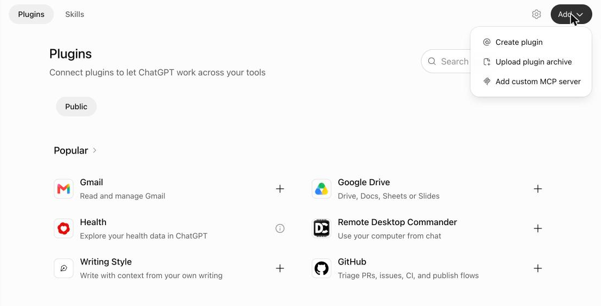

## Step 2: Fill in the form

Type the name, add a description if you like, and paste the address as the Server URL. Authentication shows OAuth: keep it. You do not need the Advanced OAuth settings.

- Name: `Site Insights by KKV Labs`
- Description (optional): `Google Analytics 4 and Search Console for every site you manage. Read only.`
- Server URL: `https://insights.kkvlabs.com/mcp`

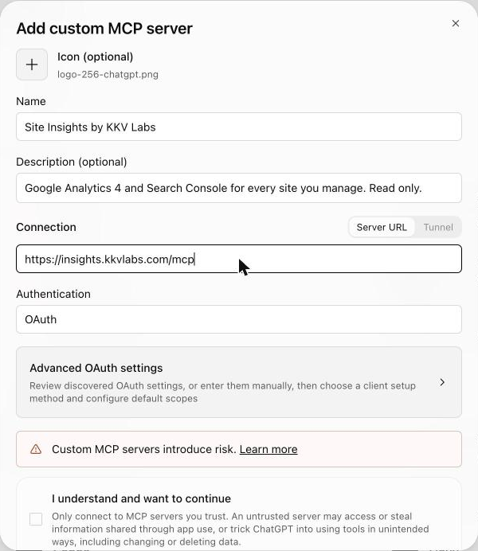

## Step 3: Confirm and create the plugin

Tick I understand and want to continue, then click Create as a plugin. A Site Insights sign in page opens.

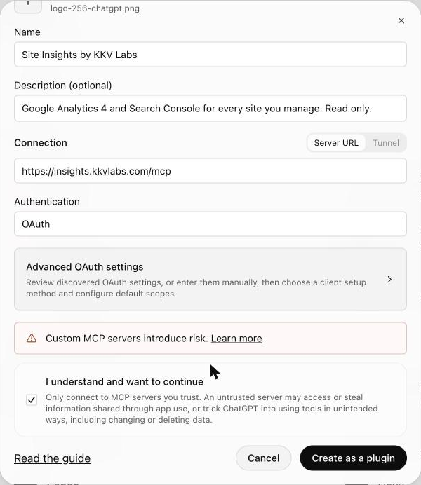

## Step 4: Sign in with Google

On the Site Insights page, click Continue with Google. Choose the Google account that can see your Analytics and Search Console.

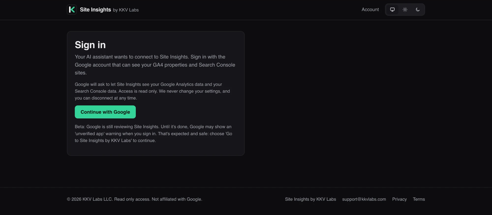

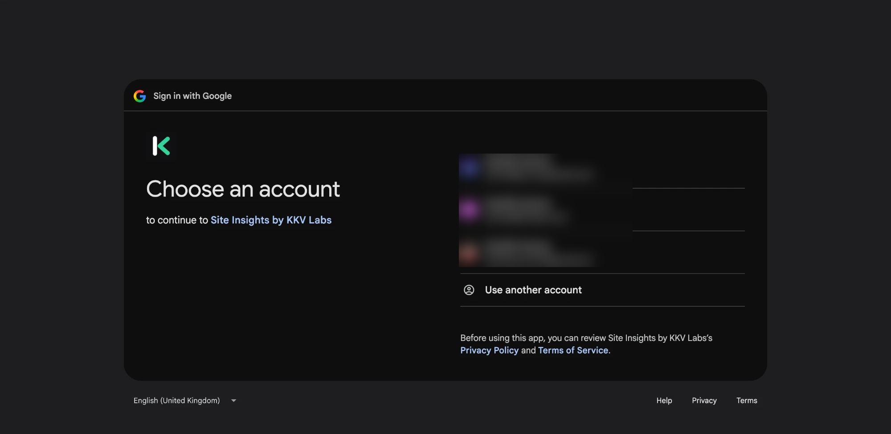

## Step 5: Allow read only access

Click Continue, then check the two read only permissions Google lists: see and download your Google Analytics data, and view Search Console data for your verified sites. Click Allow. Site Insights never changes anything in your accounts.

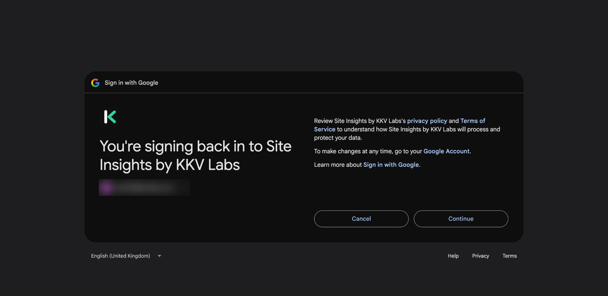

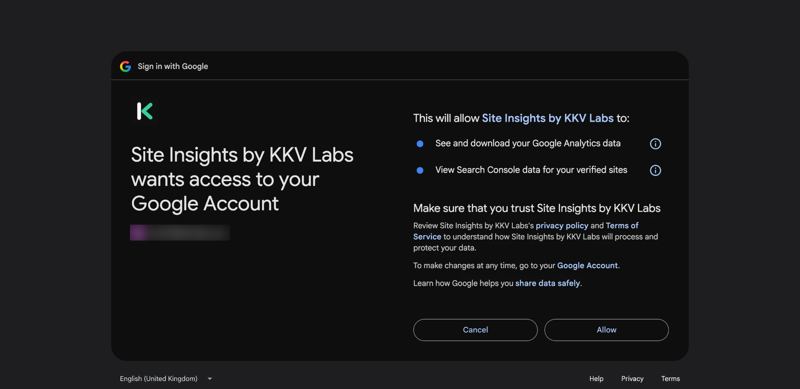

## Step 6: Allow ChatGPT

Site Insights asks Allow ChatGPT to use Site Insights? Check the account it names (Not you? lets you switch), then click Allow. You are sent back to ChatGPT.

Under Plugins, Site Insights by KKV Labs now shows as installed.

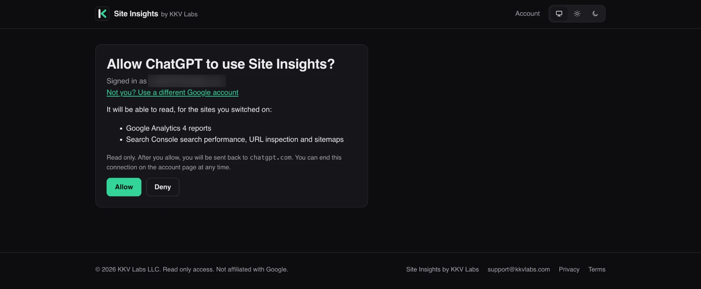

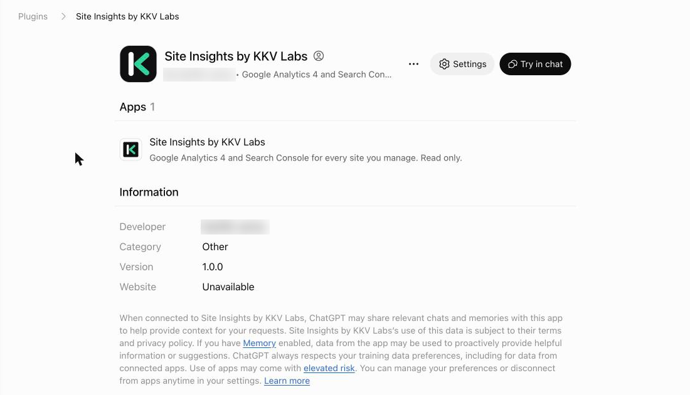

## Step 7: Switch on the sites ChatGPT may read

Open your Site Insights account page at https://insights.kkvlabs.com/account. Every GA4 property and Search Console site your Google account can see is listed and paired by domain. Use the switch on the right to turn on the sites ChatGPT may read: 1 on the Free plan, 10 on Pro, 50 on Agency.

Do this before you ask. If no site is switched on, ChatGPT answers that the site is not connected.

## Use it

Click Try in chat on the plugin page, or pick Site Insights by KKV Labs in a new chat. Then ask about a site by name or by its label.

Questions to start with:

- "How did example.com do in the last 28 days compared with the 28 days before?"
- "Which pages lost the most Google clicks this month, and when did it start?"
- "Show me quick wins: queries where I rank 4 to 20 with a low click through rate."
- "How many visits came from ChatGPT, Perplexity and other AI assistants?"
- "Compare all my client sites by clicks this month."

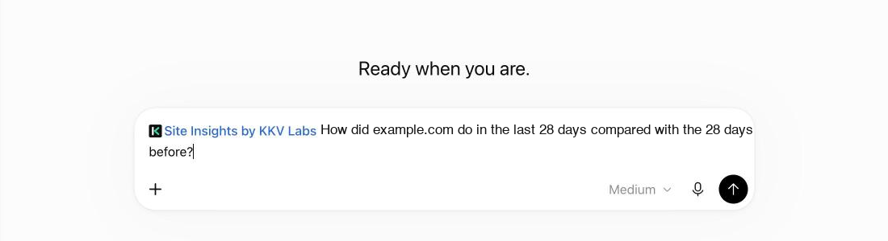

ChatGPT answers with your numbers, the date range and the changes, all calculated by Site Insights.

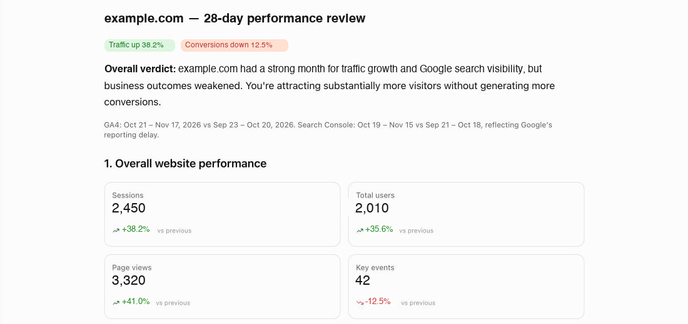

## Questions

**Can I add it in the ChatGPT mobile app?**
Adding a custom MCP server is done on chatgpt.com in a browser. Use a computer for the setup.

**ChatGPT says my site is not connected. What now?**
Open your Site Insights account page at https://insights.kkvlabs.com/account and switch the site on. Then ask again in a new chat.

**Is my data safe?**
Site Insights only asks Google for read only access. Your Google sign in token is stored encrypted. Analytics numbers are kept in a short cache for at most 60 minutes to save Google quota, then deleted. We never sell your data or use it for ads. See [privacy-summary.md](privacy-summary.md).

**How do I disconnect?**
In Site Insights, open the account page and click Disconnect Google and AI assistants, or Delete all my data. In ChatGPT, you can manage or disconnect apps in your settings. You can also remove access in your Google account settings.

**Something went wrong. Who do I ask?**
Email support@kkvlabs.com with what you saw and which step you were on.

[Back to README](../README.md)
