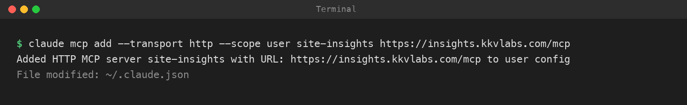
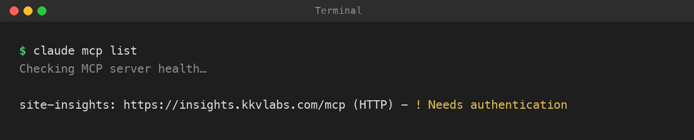
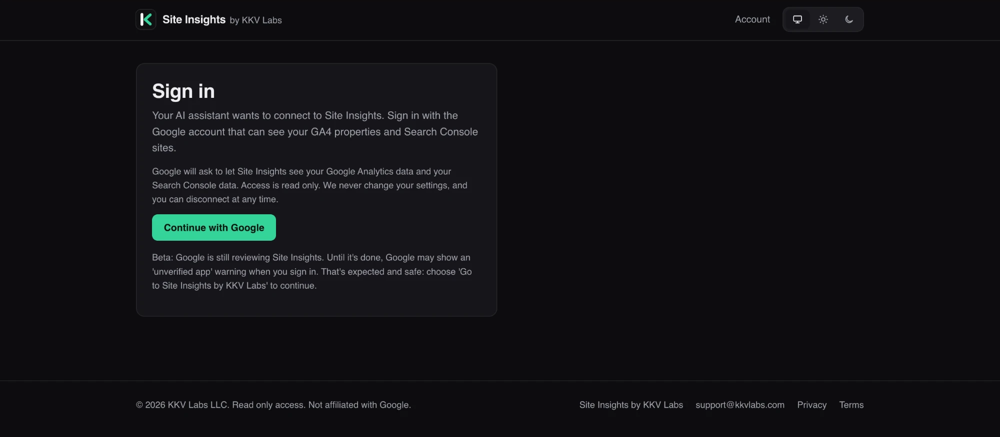
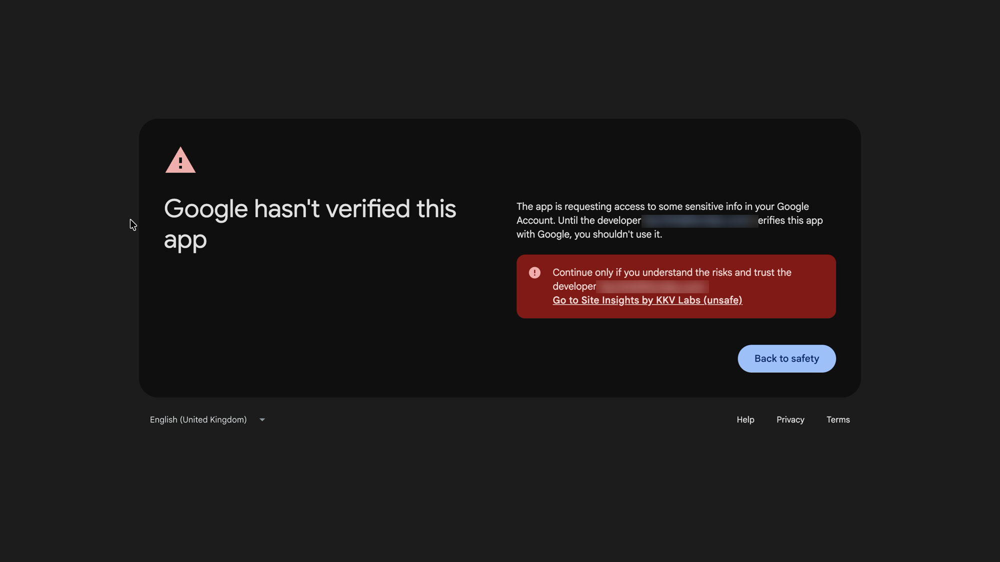
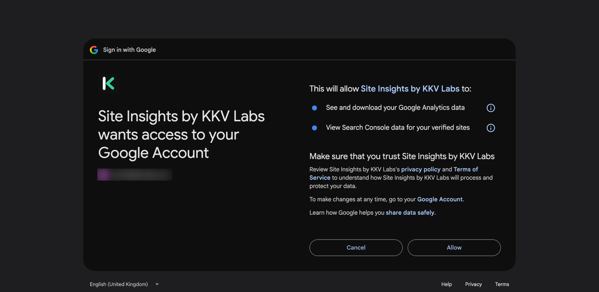
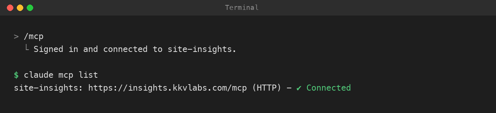
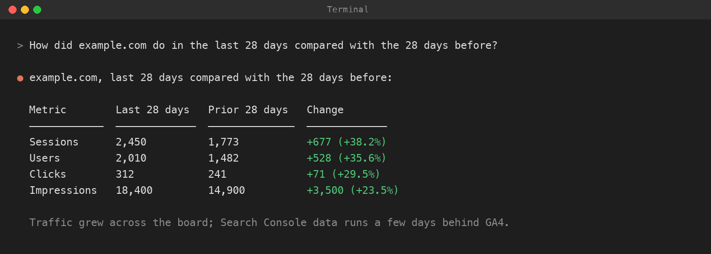

# Connect Google Search Console and Google Analytics to Claude Code

To connect Google Search Console and Google Analytics to Claude Code, add Site Insights by KKV Labs with one `claude mcp add` command, type `/mcp` to sign in with Google, and switch on your sites. It takes about two minutes and needs no Google Cloud project.

Tested end to end in the Claude Code CLI v2.1.327 on 18 Nov 2026. Terminal images use example.com and dummy numbers.

Live version of this guide: https://www.kkvlabs.com/site-insights/claude-code

You need Claude Code and a Google account that can see your Search Console site or GA4 property.

## Step 1: Add Site Insights with one command

```bash
claude mcp add --transport http --scope user site-insights https://insights.kkvlabs.com/mcp
```

`--scope user` makes Site Insights available in every folder on your machine. Leave it out to add it to the current project only. There is nothing to install and no Google Cloud project to set up.

Claude Code replies: `Added HTTP MCP server site-insights with URL: https://insights.kkvlabs.com/mcp to user config`



## Step 2: Check it is added

```bash
claude mcp list
```

Site Insights shows as Needs authentication. That is expected: you sign in next.



## Step 3: Sign in with /mcp

Start Claude Code with `claude`, type `/mcp`, pick site-insights and choose Authenticate. Your browser opens the Site Insights sign in page.

Click Continue with Google and choose the Google account that can see your Analytics and Search Console. Google lists the two read only permissions: click Allow. Then Site Insights asks Allow Claude Code to use Site Insights? Click Allow.

> **Beta note:** Google is still reviewing Site Insights. Until it's done, Google may show an "unverified app" warning when you sign in. That's expected and safe: choose "Go to Site Insights by KKV Labs" to continue. Access stays read only, and you can disconnect at any time.

The browser pages are the same ones shown in the ChatGPT guide:







## Step 4: Check it is connected

Back in Claude Code you see Signed in and connected to site-insights. Run `claude mcp list` again: it now shows Connected.



## Step 5: Switch on your sites

Open your Site Insights account page at https://insights.kkvlabs.com/account. Every GA4 property and Search Console site your Google account can see is listed and paired by domain. Switch on the sites Claude Code may read: 1 on the Free plan, 10 on Pro, 50 on Agency.

Do this before you ask. If no site is switched on, the answer says the site is not connected.

## Scopes: user, project or local

The scope decides where the server is saved and who gets it. Sign in is always per person.

| Scope | When to use it |
|---|---|
| `--scope local` | The default if you leave out `--scope`. Only in the project folder you ran it in, private to you. |
| `--scope user` | Every project on your machine, private to you. The best fit if you check sites from any folder. |
| `--scope project` | Saved in `.mcp.json` in the project, so your team gets it through git. Each person still signs in with their own Google account, and Claude Code asks each person to approve the server first. |

Only this folder (local, the default):

```bash
claude mcp add --transport http site-insights https://insights.kkvlabs.com/mcp
```

Shared with your team in `.mcp.json`:

```bash
claude mcp add --transport http --scope project site-insights https://insights.kkvlabs.com/mcp
```

## Questions to try

Claude Code can also work with the files in your project, so it can save results to a file or check your own sitemap against Google.

- "Which of my sites lost the most Google clicks this week, and on which pages?"
- "Show quick wins for example.com: queries in positions 4 to 20 with a low click through rate."
- "Is /pricing on example.com indexed? Which canonical did Google pick?"
- "How many visits did ChatGPT and Perplexity send each of my sites in the last 90 days?"
- "Save my top 500 Search Console queries for example.com this month to queries.csv."
- "Compare the URLs in ./public/sitemap.xml with what Google has indexed for example.com."



## Ready-made prompts as commands

Type `/` in Claude Code to see the Site Insights prompts. Run one with a site name after it:

```
/mcp__site-insights__weekly_site_check example.com
```

The others: `why_traffic_dropped`, `quick_wins_this_month`, `ai_traffic_report` and `client_summary_all_sites`.

## Stop the approval prompts

By default, Claude Code asks before each Site Insights tool call. To stop that, type `/permissions` and add this allow rule, or put it under `permissions.allow` in your `settings.json`. The tools only read data.

```
mcp__site-insights__*
```

Running Claude Code without the chat, in a script? Allow the tool on the command line:

```bash
claude -p "How did example.com do last week?" --allowedTools mcp__site-insights__site_overview
```

## Troubleshooting

**Site Insights shows Needs authentication.**
Type `/mcp` in Claude Code, pick site-insights and sign in again. If Google access was removed, the next call asks you to sign in too.

**Claude says there are no sites.**
Either you signed in with a Google account that cannot see your properties, or no site is switched on yet. Check https://insights.kkvlabs.com/account.

**A project scoped server is pending approval.**
Claude Code asks before it uses a server from a project's `.mcp.json`. Start `claude` in that folder and approve it. `claude mcp reset-project-choices` resets those choices.

**You have used all your lookups for today.**
The Free plan allows 10 tool calls a day, and the count resets at midnight UTC. Pro and Agency have no daily limit under fair use.

**How do I remove it?**
Run `claude mcp logout site-insights`, then `claude mcp remove site-insights`. To revoke Google access too, use Disconnect or Delete all my data on your Site Insights account page.

Still stuck? Email support@kkvlabs.com with the step you were on.

## Questions

**Is there a Google Analytics skill for Claude Code?**
You do not need one. Site Insights is an MCP server, so its tools load in Claude Code as soon as you add it. Its ready-made prompts appear as commands, and you can still wrap your own routine in a skill if you like.

**Do I need a Google Cloud project or credentials file?**
No. Site Insights is hosted: you sign in with Google in the browser. Google's own analytics-mcp server is the do it yourself option and needs a Cloud project, gcloud credentials and pipx. KKV Labs has a guide for it: https://www.kkvlabs.com/guides/how-to-set-up-google-analytics-mcp-server

**Does it cost anything?**
It is free for one site with 10 lookups a day. Pro is $9 a month for 10 sites and Agency is $49 a month for 50 sites.

[Back to README](../README.md)
