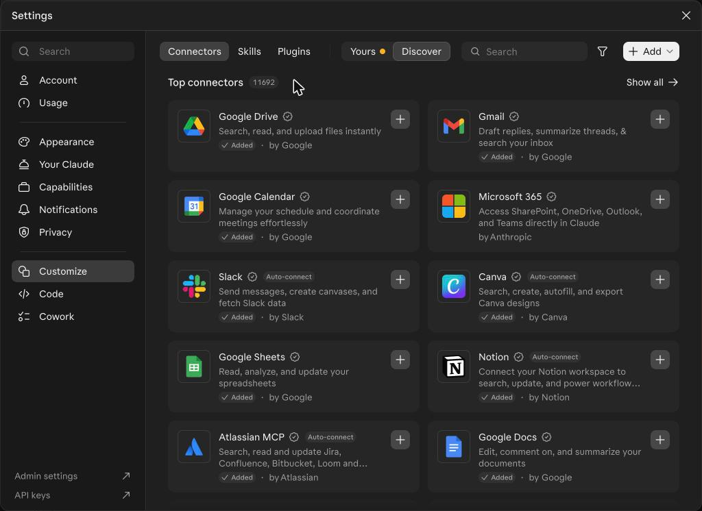
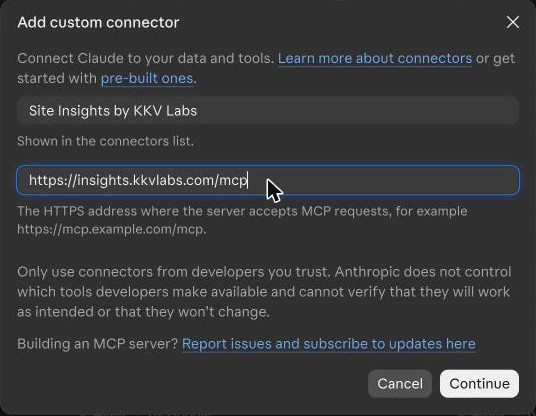
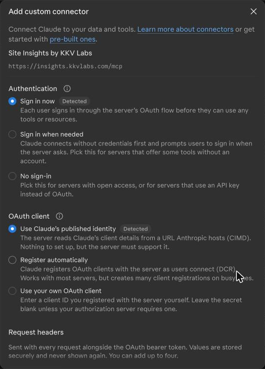
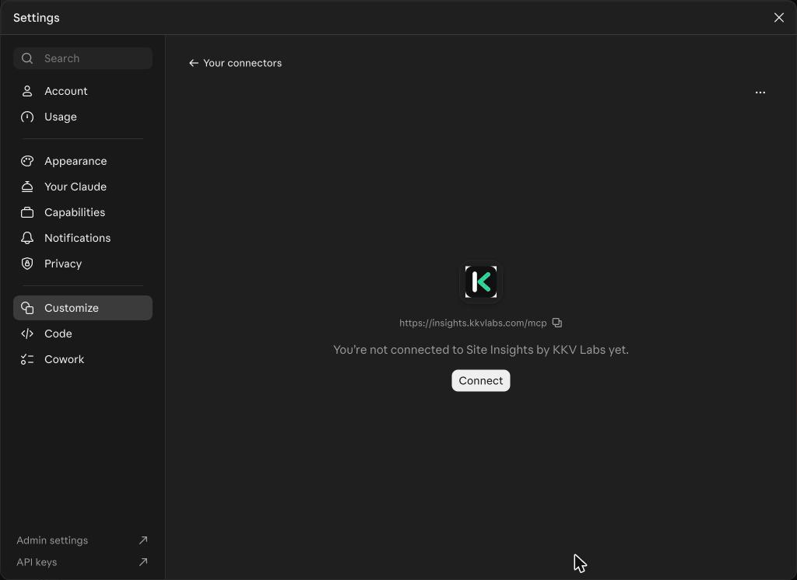
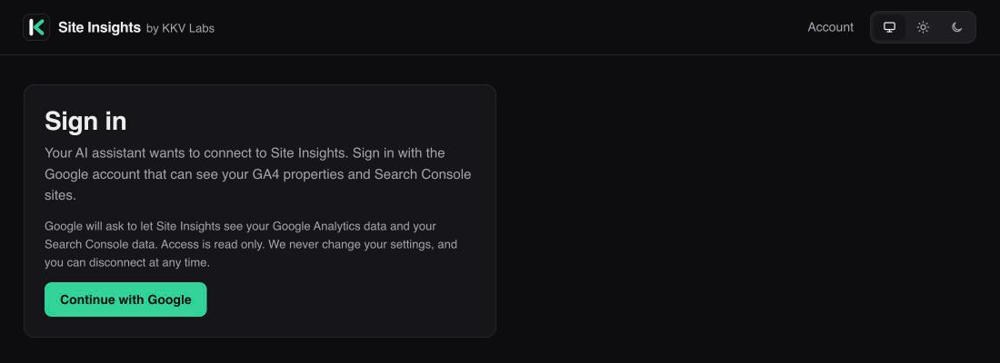
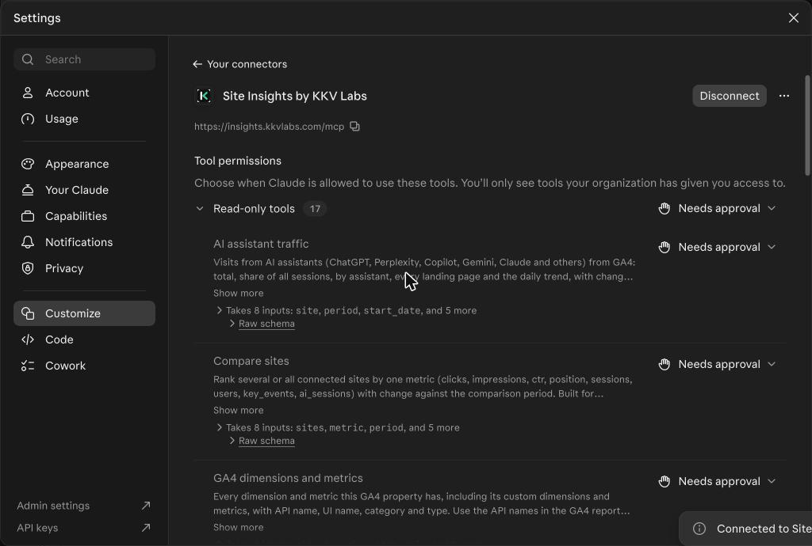
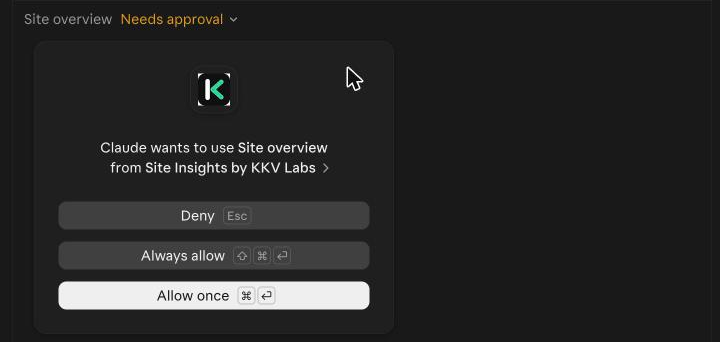

# Connect Google Analytics and Search Console to Claude

To connect Google Analytics to Claude, add Site Insights by KKV Labs as a custom connector, sign in with Google and switch on your sites. It takes about two minutes, it is read only, and it brings your Search Console data along too.

Tested end to end on claude.ai on 17 Nov 2026. Screenshots show example details only.

Live version of this guide: https://www.kkvlabs.com/site-insights/connect-claude

## What you need

- A Claude account: Free, Pro, Max, Team or Enterprise. On Team and Enterprise, an owner may need to allow custom connectors first.
- A Google account that can see your GA4 property or Search Console site. Viewer is enough.
- The Site Insights address:

```
https://insights.kkvlabs.com/mcp
```

Site Insights by KKV Labs is also listed in the Claude connector directory: https://claude.com/marketplace/connectors/site-insights. The steps below add it as a custom connector, which works on every Claude plan listed above.

## Step 1: Open Connectors in Claude

In Claude, open Customize in the left sidebar (or Settings, then Customize), then Connectors. Click + Add in the top right corner and choose Add custom connector.



## Step 2: Paste the Site Insights address

Type the name and paste the address, then click Continue.

- Name: `Site Insights by KKV Labs`
- MCP server URL: `https://insights.kkvlabs.com/mcp`



## Step 3: Keep the detected sign in settings

Claude finds our sign in settings on its own: Sign in now and Use Claude's published identity, both marked Detected. Do not change anything. Scroll down and click Add.



## Step 4: Click Connect

Site Insights now appears in your connectors. Click Connect.



## Step 5: Sign in with Google

A Site Insights page opens. Click Continue with Google and choose the Google account that can see your Analytics and Search Console.

Google asks you to let Site Insights see your Google Analytics data and your Search Console data. Tick both and continue. Both permissions are read only: Site Insights can never change your settings.

> **Beta note:** Google is still reviewing Site Insights. Until it's done, Google may show an "unverified app" warning when you sign in. That's expected and safe: choose "Go to Site Insights by KKV Labs" to continue. Access stays read only, and you can disconnect at any time.



## Step 6: Allow Claude

Site Insights asks you to confirm that Claude may read your data. Click Allow and you are sent back to Claude.

Claude now shows Connected to Site Insights by KKV Labs and lists the tools it can use. Every tool is read only.



## Step 7: Choose which sites Claude may read

Open your Site Insights account page at https://insights.kkvlabs.com/account. Every GA4 property and Search Console site your Google account can see is listed and paired by domain.

Use the switch on the right to turn on the sites Claude may read. The Free plan includes 1 site, Pro 10 and Agency 50. You can also add a label such as Client: Acme.

## Use it

Open a new chat and ask about a site by name or by its label. If you do not name one, Claude asks Site Insights which sites you have.

Questions to start with:

- "How did example.com do in the last 28 days compared with the 28 days before?"
- "Which pages lost the most Google clicks this month, and when did it start?"
- "Show me quick wins: queries where I rank 4 to 20 with a low click through rate."
- "How many visits came from ChatGPT, Perplexity and other AI assistants?"
- "Compare all my client sites by clicks this month."

The first time Claude uses a Site Insights tool it asks for permission. Click Allow once, or Always allow to stop being asked. Claude then answers with your numbers, the date range and the changes, all calculated by Site Insights.



**Tip: stop the approval prompts.** By default, Claude asks before each tool call. To stop that, open Customize, then Connectors, pick Site Insights by KKV Labs and set Read-only tools to Always allow. The tools only read data.

## Claude desktop and mobile apps

Connectors you add on claude.ai also appear in the desktop and mobile apps. In the desktop app the steps are the same: Customize, Connectors, + Add, Add custom connector.

## Claude Code

See [claude-code.md](claude-code.md).

## Questions

**Which Claude plans can connect Google Analytics?**
Free, Pro, Max, Team and Enterprise can all add a custom connector. On Team and Enterprise, an owner may need to allow custom connectors first.

**Which Google access do I need?**
A Google account that can see the GA4 property or the Search Console site. Viewer access is enough.

**Is my data safe?**
Site Insights only asks Google for read only access. Your Google sign in token is stored encrypted. Analytics numbers are kept in a short cache for at most 60 minutes to save Google quota, then deleted. We never sell your data or use it for ads. See [privacy-summary.md](privacy-summary.md).

**How do I disconnect?**
In Claude, open the connector and click Disconnect. In Site Insights, open the account page and click Disconnect Google and AI assistants, or Delete all my data. You can also remove access in your Google account settings.

**Something went wrong. Who do I ask?**
Email support@kkvlabs.com with what you saw and which step you were on.

[Back to README](../README.md)
